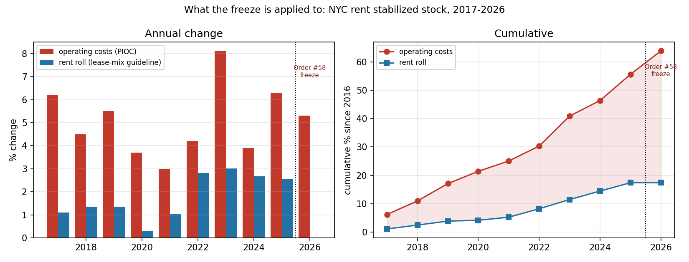
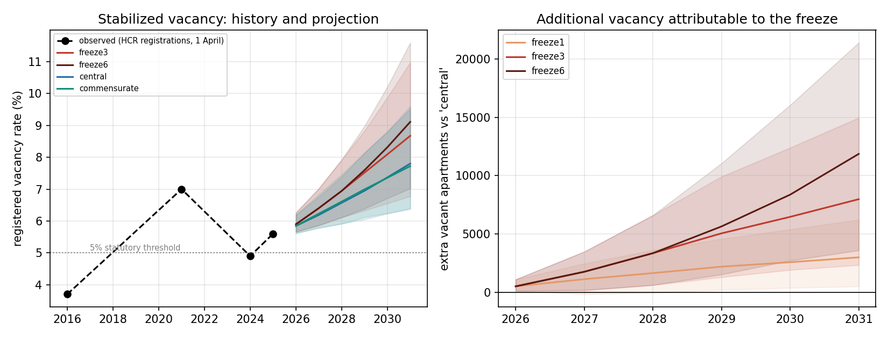
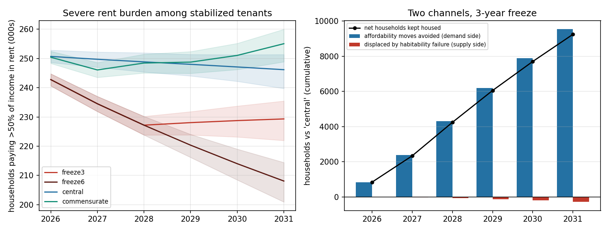
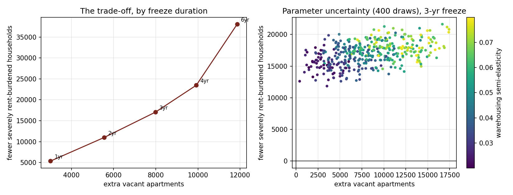
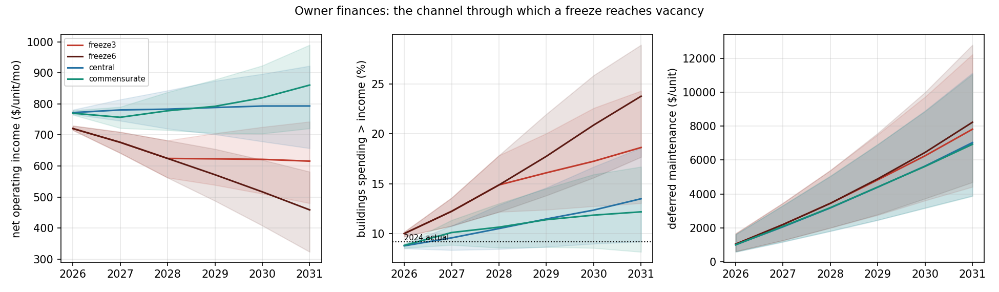
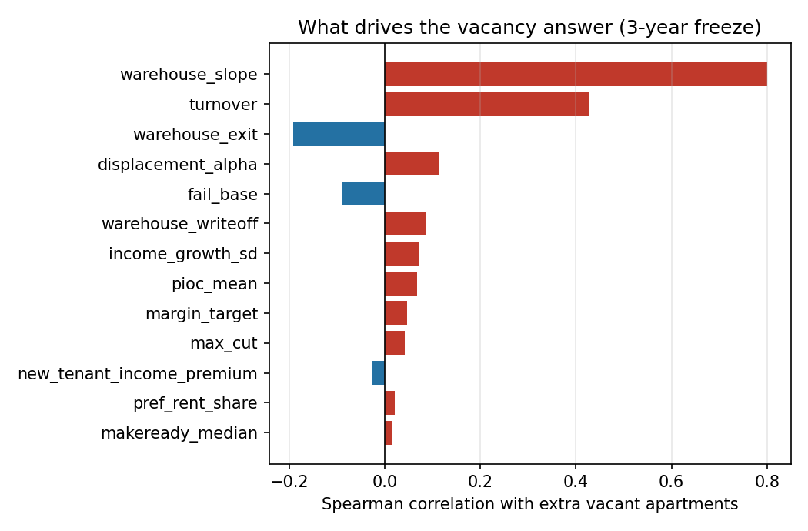

# NYC rent freeze: model results

Generated by `run_rent_freeze.py` with 400 Monte Carlo draws, 80,000 synthetic units, 6 guideline years from 2026.
All intervals are 5th-95th percentiles across parameter draws. Scenario comparisons are paired: every scenario sees the same cohort, parameters and cost-inflation path.

## 1. The data: what a freeze is being applied to

| Quantity | Value |
|---|---|
| Rent stabilized apartments | 960,000 (rent CONTROLLED, a separate programme not covered by the order: 24,020) |
| Order #58 (1 Oct 2026 - 30 Sep 2027) | 0.0% one-year, 0.0% two-year, adopted 7-1 |
| Operating costs, cumulative 2017-2026 (PIOC) | +63.8% |
| Rent roll, cumulative 2017-2026 (guidelines) | +17.4% |
| Mean annual PIOC change 2017-2026 | 5.07% |
| Mean one-year guideline 2017-2026 | 1.70% |
| RGB projection for the 2027 PIOC | +4.1% |
| Avg O&M cost per unit per month (2024 RPIE) | $1,203 (median $1,094) |
| Avg collected rent per unit per month (2024) | $1,681 |
| Avg net operating income per unit per month | $688 |
| Buildings spending more than they collect | 9.2% (was 4.9% in 2016) |
| Registered stabilized vacancy, April 2025 | 5.6% (57,000 units; 3.7% in 2016) |
| Vacant AND available (2023 HVS) | 0.98% stabilized, 1.41% citywide |
| Median stabilized tenant income (2022) | $60,000 |
| Median stabilized contract rent (2023) | $1,500 |
| Stabilized tenants rent burdened / severely | 45.5% / 27.2% |
| Median renter income growth 2024 | +5.7% nominal, +1.8% real |
| Household income CAGR 2006-2023, nominal | 1.78%/yr bottom quintile vs 3.58%/yr top |

Over 2017-2026 operating costs rose **63.8%** while the guideline-driven rent roll rose **17.4%**. The freeze starts from an already-compressed margin.

## 2. Calibration and identification

- Rent-burden lognormal fitted to three published targets (median 27.0%, P(>30%)=45.5%, P(>50%)=27.2%); worst residual 0.0018.
- Guideline-on-PIOC regression: slope +0.328 (R2 0.211) on all years, +0.037 (R2 0.004, p=0.89) excluding freeze years. The Board's guideline is not a function of its cost index, so three counterfactuals are carried rather than one fitted rule.
- Improvement recovery fell from $2.66 to $0.74 of capitalised rent per dollar spent at HSTPA (2019). That episode anchors the warehousing semi-elasticity at 0.028-0.056; the Monte Carlo sweeps (0.02, 0.08).

| t=0 cross-section | model | published target |
|---|---|---|
| mean rent ($/mo) | 1,846.25 | 1,846.25 |
| mean O&M cost ($/mo) | 1,321.09 | 1,306.17 |
| mean NOI ($/mo) | 754.71 | 747.01 |
| cost / income (agg) | 0.64 | 0.63 |
| distressed share (%) | 8.30 | 9.20 |
| median tenant income ($) | 72,930.38 | 72,930.38 |
| median rent burden (%) | 27.04 | 27.00 |
| burdened >30% (%) | 45.95 | 45.50 |
| severely burdened >50% (%) | 27.51 | 27.20 |
| registered vacancy (%) | 5.60 | 5.60 |

## 3. Headline: 3-year freeze vs the 'central' counterfactual

Paired differences (3-year freeze minus 'central'), median [5th, 95th pct], at 2031-32:

| Quantity | Difference at horizon | Peak year | Peak difference |
|---|---|---|---|
| Vacant stabilized apartments (stock) | 7,985  [2,346, 14,964] | 2031 | 7,985 |
| Registered vacancy rate | 0.85 pp  [0.25 pp, 1.59 pp] | 2031 | 0.85 pp |
|   of which warehoused (off market) | 8,082  [2,375, 15,165] | 2031 | 8,082 |
| Households paying >50% of income in rent | -17,040  [-19,886, -13,915] | 2028 | -21,504 |
| Households paying >30% of income in rent | -22,758  [-26,474, -18,815] | 2028 | -26,694 |
| Cumulative affordability-driven moves | -9,535  [-15,156, -5,226] | 2031 | -9,535 |
| Cumulative displacements, habitability failure | 288.0  [-24.6, 816.6] | 2031 | 288.0 |
| Cumulative apartments lost from the stock | 840.0  [178.8, 1,776] | 2031 | 840.0 |
| Mean net operating income, $/unit/month | -176.9  [-183.9, -170.2] | 2031 | -176.9 |
| Buildings spending more than they collect | 5.07 pp  [3.87 pp, 5.91 pp] | 2031 | 5.07 pp |
| Deferred maintenance, $/unit | 788.6  [530.9, 1,098] | 2031 | 788.6 |

**Net effect on sitting households** at the horizon: the freeze avoids 9,535 affordability-driven moves and causes 288.0 additional displacements through habitability failure, for a net 9,247 households [4,410, 15,181] who stay put.

## 4. How much the answer depends on the counterfactual

| Counterfactual | 1-yr guideline | Extra vacant units | Fewer severely burdened |
|---|---|---|---|
| low | 2.32% | 5,336  [1,579, 10,380] | 8,010  [5,567, 10,572] |
| central | 3.00% | 7,985  [2,346, 14,964] | 17,040  [13,915, 19,886] |
| commensurate | 3.29% | 8,680  [2,663, 15,746] | 26,052  [22,966, 28,706] |

## 5. Effect of freeze duration

| Freeze length | Extra vacant units | Fewer severely burdened | Extra apartments lost |
|---|---|---|---|
| 1 year | 3,006  [509.4, 6,217] | 5,346  [3,120, 7,285] | 342.0  [-168.6, 961.2] |
| 2 years | 5,550  [1,596, 10,690] | 10,980  [8,195, 13,285] | 636.0  [12.0, 1,405] |
| 3 years | 7,985  [2,346, 14,964] | 17,040  [13,915, 19,886] | 840.0  [178.8, 1,776] |
| 4 years | 9,925  [2,974, 18,287] | 23,472  [19,881, 26,438] | 1,038  [216.0, 2,100] |
| 6 years (whole horizon) | 11,863  [3,603, 21,392] | 38,064  [34,640, 41,065] | 1,158  [322.8, 2,317] |

## 6. What the answer is sensitive to

Spearman rank correlation between each swept parameter and the outcome, across 400 draws:

| Parameter | corr with extra vacant units | corr with fewer severely burdened |
|---|---|---|
| `warehouse_slope` | +0.800 | +0.583 |
| `turnover` | +0.426 | -0.296 |
| `warehouse_exit` | -0.192 | -0.169 |
| `displacement_alpha` | +0.113 | -0.116 |
| `fail_base` | -0.089 | +0.068 |
| `warehouse_writeoff` | +0.088 | +0.087 |
| `income_growth_sd` | +0.073 | +0.005 |
| `pioc_mean` | +0.067 | +0.078 |
| `margin_target` | +0.046 | +0.003 |
| `max_cut` | +0.041 | +0.077 |
| `new_tenant_income_premium` | -0.026 | +0.011 |
| `pref_rent_share` | +0.021 | -0.000 |
| `makeready_median` | +0.017 | +0.039 |

## Figures

